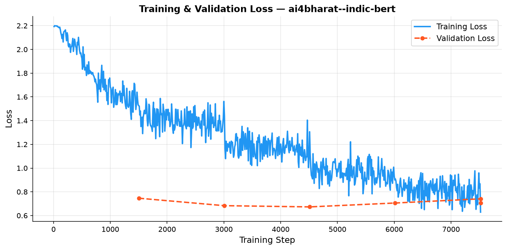
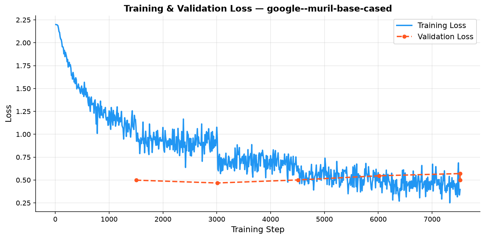
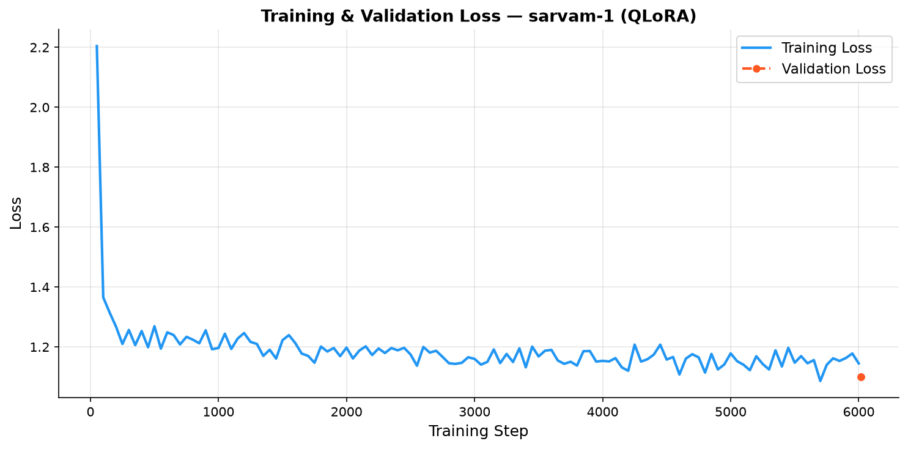
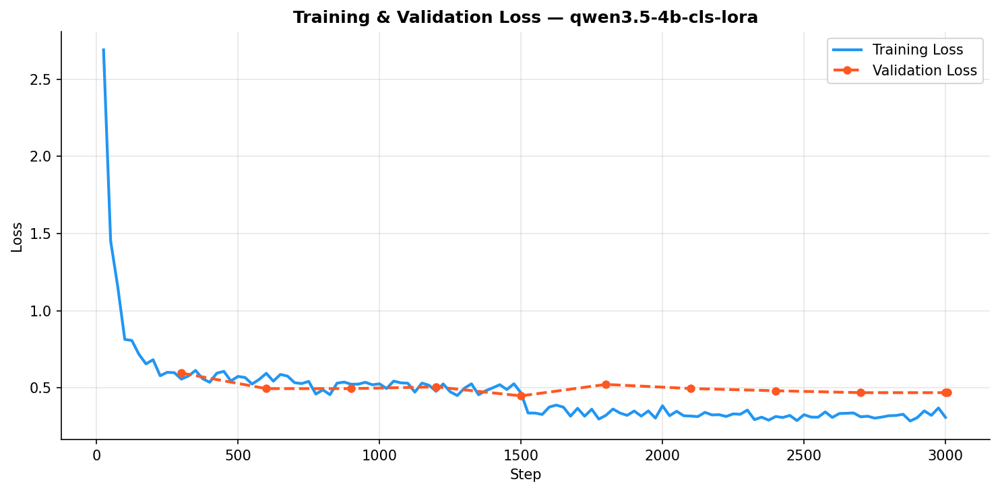

# Fine-tuning Small Language Models for Multilingual Sentiment Analysis
### Marathi / Code-mixed Text — Academic Mini-Project

---

## Project Overview

This project benchmarks a range of models — from a classical TF-IDF baseline to encoder-based multilingual BERTs, a 2B-parameter Generative Small Language Model (SLM), and a **4B-parameter decoder backbone with LoRA + sequence classification head** — on Marathi and code-mixed sentiment classification using the [`l3cube-pune/marathi-sentiment-md`](https://huggingface.co/datasets/l3cube-pune/marathi-sentiment-md) dataset.

| Component | Detail |
|---|---|
| **Decoder Backbone (LoRA + Cls Head)** | `Qwen/Qwen3.5-4B` (4B params, LoRA r=16 + linear head, bf16) |
| **Generative SLM (QLoRA)** | `sarvamai/sarvam-1` (2B params, 4-bit NF4 QLoRA) |
| **Encoder Model 1** | `google/muril-base-cased` (MuRIL, 236M params) |
| **Encoder Model 2** | `ai4bharat/indic-bert` (IndicBERT, 110M params) |
| **Classical Baseline** | TF-IDF (char n-gram) + Logistic Regression |
| **Dataset** | `l3cube-pune/marathi-sentiment-md` (48,114 train / 6,000 val / 6,750 test) |
| **Hardware** | NVIDIA GeForce RTX 4090 — 24 GB VRAM (Windows 11 Pro) |

---

## 📊 Results

All models evaluated on the **L3Cube-MahaSent-MD** test set (6,750 samples, 3-class: Negative / Neutral / Positive).

### 1. Main Test Set Performance

| Model | Macro F1 | Macro Precision | Macro Recall | Accuracy | Latency |
|---|---|---|---|---|---|
| TF-IDF + Logistic Regression | 49.46% | 49.83% | 49.49% | — | — |
| 🟡 **Sarvam-1** (`sarvamai/sarvam-1`, QLoRA 1-epoch) | 63.45% | 69.52% | 65.26% | 65.26% | 93.05 ms/sample |
| 🔹 IndicBERT (`ai4bharat/indic-bert`) | 71.07% | 71.42% | 70.92% | 70.92% | 0.39 ms/sample |
| 🟣 **MuRIL** (`google/muril-base-cased`) | 81.20% | 81.17% | 81.28% | 81.28% | 0.42 ms/sample |
| 🟢 **Qwen3.5-4B (LoRA + cls head)** | **81.38%** | **81.39%** | **81.42%** | **81.42%** | 10.22 ms/sample |

> **Key Insight:** **Qwen3.5-4B (LoRA + cls head) beats MuRIL (81.20% → 81.38% Macro F1)**, establishing the highest overall performance on the official MahaSent-MD test set. By combining a 4B modern decoder backbone with an efficient low-rank adaptation (LoRA r=16, alpha=32) and a trainable sequence classification head (`score`), it surpasses dedicated encoder models trained for 5 epochs while requiring only 21.2M trainable parameters (0.47% of total).

---

### 2. Cross-Domain Generalisation (4 L3Cube Sub-domains)

| Domain | Sarvam-1 F1 | IndicBERT F1 | MuRIL F1 | Qwen3.5-4B F1 |
|---|---|---|---|---|
| Movie Reviews | 66.77% | 68.11% | **79.29%** | 78.86% |
| Generic Tweets | 64.16% | 67.02% | 77.94% | **78.76%** |
| TV Subtitles | 66.14% | 72.49% | 79.66% | **80.73%** |
| Political Tweets | 64.88% | 79.22% | 85.14% | **85.86%** |

> Qwen3.5-4B outperforms MuRIL on **3 out of 4 sub-domains** (Generic Tweets, TV Subtitles, and Political Tweets), showing superior cross-domain robustness on diverse social media and translated content.

---

### 3. Code-Mixed Evaluation (30 Romanized Marathi / Hindi-English Sentences)

| Model | Correct | Accuracy |
|---|---|---|
| 🟢 **Qwen3.5-4B (LoRA + cls head)** | 17 / 30 | 56.7% |
| 🔹 IndicBERT | 19 / 30 | 63.3% |
| 🟣 MuRIL | 24 / 30 | 80.0% |
| 🟡 **Sarvam-1 (QLoRA)** | **26 / 30** | **86.7%** |

> Qwen3.5-4B with sequence classification head excels on Devanagari script text and achieves **100% precision on Positive code-mixed expressions** (10/10 correct), but generative SLMs (Sarvam-1) remain strongest at interpreting conversational Romanized slang out-of-the-box due to generative Indian web tokenisation.

---

### 4. Training Loss Curves

| IndicBERT | MuRIL | Sarvam-1 | Qwen3.5-4B |
|---|---|---|---|
|  |  |  |  |

---

## Directory Structure

```
NLP/
├── app.py                   # Streamlit interactive web dashboard
├── requirements.txt         # Pinned production dependencies
├── README.md                # Documentation and benchmark tables
├── src/
│   ├── data_loader.py       # Dataset loading, normalization & tokenisation
│   ├── baseline.py          # TF-IDF + Logistic Regression baseline
│   ├── train.py             # Hugging Face Trainer fine-tuning (encoders)
│   ├── evaluate.py          # Metrics + confusion matrix plots + latency
│   ├── train_sarvam.py      # Sarvam-1 QLoRA fine-tuning
│   ├── evaluate_sarvam.py   # Sarvam-1 generative evaluation
│   ├── train_cls_lora.py    # Qwen3.5-4B LoRA + cls head fine-tuning (NEW)
│   ├── evaluate_cls_lora.py  # Qwen3.5-4B LoRA evaluation on test set (NEW)
│   ├── domain_eval.py       # Cross-domain evaluation (all models)
│   ├── predict.py           # Real-time CLI sentiment inference (all models)
│   └── code_mixed_eval.py   # 30-sentence code-mixed test set evaluation
├── outputs/                 # Saved encoder model checkpoints (gitignored)
├── saved_models/            # Saved LoRA adapters (gitignored)
│   ├── sarvam-1-lora/       # Sarvam-1 generative LoRA adapter
│   └── qwen3.5-4b-cls-lora/ # Qwen3.5-4B sequence classification adapter & head
└── results/                 # Metrics CSVs, confusion matrices, loss curves & plots
    ├── qwen3.5-4b-cls-lora/ # Full training steps, eval curves, and system metadata
    ├── domain_eval/         # Per-domain CSVs, bar chart & latency chart
    └── code_mixed_eval/     # Code-mixed CSVs & confusion matrix
```

---

## Setup

### Step 1 — Create and Activate a Virtual Environment

```bash
python -m venv venv

# Activate (Windows PowerShell)
Set-ExecutionPolicy -Scope Process -ExecutionPolicy Bypass
.\venv\Scripts\Activate.ps1

# Activate (Windows Git Bash)
source venv/Scripts/activate
```

---

### Step 2 — Install CUDA-enabled PyTorch (CUDA 12.4 — RTX 30/40 Series)

```bash
pip install torch==2.6.0+cu124 torchvision==0.21.0+cu124 torchaudio==2.6.0+cu124 --index-url https://download.pytorch.org/whl/cu124
```

Verify:
```bash
python -c "import torch; print('CUDA:', torch.cuda.is_available(), 'GPU:', torch.cuda.get_device_name(0))"
```

---

### Step 3 — Install All Dependencies

```bash
pip install -r requirements.txt
```

---

## Running the Pipeline

All scripts must be run from the **project root** (`NLP/`).

---

### 4a. Classical Baseline

```bash
python src/baseline.py           # Full dataset
python src/baseline.py --debug   # Quick 100-sample test
```

---

### 4b. Fine-tune Encoder Models (IndicBERT & MuRIL)

```bash
python src/train.py --model ai4bharat/indic-bert
python src/train.py --model google/muril-base-cased
```

---

### 4c. Evaluate Encoder Models

```bash
python src/evaluate.py --model_dir outputs/ai4bharat--indic-bert --data_dir data/
python src/evaluate.py --model_dir outputs/google--muril-base-cased --data_dir data/
```

---

### 4d. Fine-tune Sarvam-1 (2B Generative SLM — 4-bit QLoRA)

```bash
python src/train_sarvam.py --data_dir data/ --epochs 1 --batch_size 8 --grad_accum 1
```

---

### 4e. Evaluate Sarvam-1

```bash
python src/evaluate_sarvam.py --data_dir data/ --batch_size 8
```

---

### 4f. Cross-Domain Evaluation

```bash
# Encoder models
python src/domain_eval.py --model_dir outputs/ai4bharat--indic-bert --data_dir data/
python src/domain_eval.py --model_dir outputs/google--muril-base-cased --data_dir data/

# Sarvam-1 Generative QLoRA
python src/domain_eval.py --model_dir saved_models/sarvam-1-lora --data_dir data/

# Qwen3.5-4B LoRA + Classification Head
python src/domain_eval.py --model_dir saved_models/qwen3.5-4b-cls-lora --data_dir data/
```

---

### 4g. Code-Mixed Evaluation

```bash
python src/code_mixed_eval.py --model_dir outputs/ai4bharat--indic-bert
python src/code_mixed_eval.py --model_dir outputs/google--muril-base-cased
python src/code_mixed_eval.py --model_dir saved_models/sarvam-1-lora
python src/code_mixed_eval.py --model_dir saved_models/qwen3.5-4b-cls-lora
```

---

### 4h. Interactive Web App (Streamlit)

```bash
streamlit run app.py
```

---

### 4i. Qwen3.5-4B LoRA + Classification Head

Fine-tunes the `Qwen/Qwen3.5-4B` decoder backbone with a low-rank adapter (`LoRA`) and a trainable linear classification head (`score`, 3 classes) using `bfloat16` and scaled dot-product attention (`sdpa`).

#### Commands

```bash
# 1. Quick Debug Sanity-Check (~500 samples, 50 steps)
python src/train_cls_lora.py --model Qwen/Qwen3.5-4B --data_dir data/ --debug

# 2. Full Training (2 Epochs, batch size 32, cosine schedule)
python src/train_cls_lora.py --model Qwen/Qwen3.5-4B --data_dir data/ \
    --epochs 2 --batch_size 32 --grad_accum 1 --lr 1e-4 \
    --lora_r 16 --lora_alpha 32 --max_length 128 --seed 42 \
    --output_name qwen3.5-4b-cls-lora

# 3. Test Set Evaluation (Merges LoRA adapter & reports test metrics + confusion matrix)
python src/evaluate_cls_lora.py --model_dir saved_models/qwen3.5-4b-cls-lora --data_dir data/

# 4. Cross-Domain Generalisation
python src/domain_eval.py --model_dir saved_models/qwen3.5-4b-cls-lora --data_dir data/

# 5. Code-Mixed Evaluation
python src/code_mixed_eval.py --model_dir saved_models/qwen3.5-4b-cls-lora
```

#### Hyperparameter Configuration

| Parameter | Value | Description |
|---|---|---|
| **Base Model** | `Qwen/Qwen3.5-4B` | 4B decoder architecture |
| **Task Type** | `SEQ_CLS` | Non-generative Sequence Classification |
| **Precision** | `bfloat16` | Native bf16 (no 4-bit quantisation) |
| **Attention** | `sdpa` | PyTorch native scaled dot-product attention |
| **Classification Head** | `nn.Linear(2560, 3)` | Trainable linear layer (`score`) |
| **LoRA Target Modules** | `q_proj, k_proj, v_proj, o_proj, gate_proj, up_proj, down_proj` | All linear layers in attention and MLP blocks |
| **LoRA Rank ($r$)** | 16 | Rank of update matrices |
| **LoRA Alpha ($\alpha$)** | 32 | Scaling factor |
| **LoRA Dropout** | 0.05 | Regularization |
| **Trainable Parameters** | 21,241,344 / 4,560,514,560 (0.47%) | Extremely parameter-efficient |
| **Batch Size** | 32 | Effective batch size 32 (`grad_accum=1`) |
| **Learning Rate** | `1e-4` | Cosine decay schedule with 5% warmup |
| **Gradient Checkpointing** | Enabled | `use_reentrant=False` for memory efficiency |
| **Optimizer** | `adamw_torch_fused` | Fast CUDA-fused AdamW |
| **Evaluation Strategy** | Every 300 steps | Saves best checkpoint by validation Macro F1 |
| **Peak VRAM** | 15.41 GB | Well within the 24 GB budget of RTX 4090 |
| **Training Time** | 115.49 min | 2 full epochs (3,008 steps) |

---

## VRAM Usage Guide

| Stage | Model | Hardware | Peak VRAM |
|---|---|---|---|
| Encoder inference (fp16, batch=32) | IndicBERT / MuRIL | RTX 4090 | ~2.5 GB |
| Encoder training (fp16, batch=16) | IndicBERT / MuRIL | RTX 4090 | ~5–6 GB |
| SLM inference (4-bit NF4) | Sarvam-1 (2B) | RTX 4090 | ~2.5–3 GB |
| SLM training (4-bit NF4, QLoRA) | Sarvam-1 (2B) | RTX 4090 | ~4–5 GB |
| **Decoder LoRA training (bf16, batch=32)** | **Qwen3.5-4B** | **RTX 4090** | **15.41 GB** |
| **Decoder inference (bf16, batch=32)** | **Qwen3.5-4B** | **RTX 4090** | **12.20 GB** |

---

## Troubleshooting

| Problem | Fix |
|---|---|
| `Cannot handle batch sizes > 1 if no padding token is defined` | Set `pad_token_id` on both `model.config` and `model.config.get_text_config()` |
| `The model did not return a loss` | Set `remove_unused_columns=False` in `TrainingArguments` |
| `ExecutionPolicy` error (PowerShell) | `Set-ExecutionPolicy -Scope Process -ExecutionPolicy Bypass` |
| Model download slow / offline | Set `$env:HF_HUB_OFFLINE="1"` after initial download |
| `torchvision::nms` error | Install matching PyTorch and torchvision wheels (e.g. `torch==2.6.0+cu124` + `torchvision==0.21.0+cu124`) |
